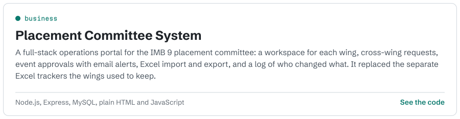
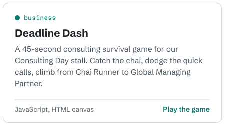
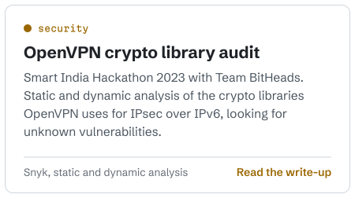
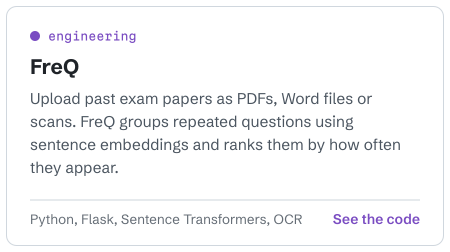
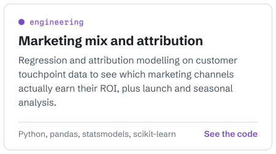
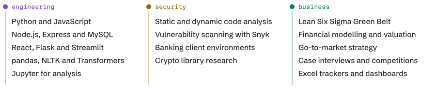

<picture>
  <source media="(prefers-color-scheme: dark)" srcset="profile/hero-dark.svg">
  
</picture>

 

Right now I coordinate strategy and operations for the IMB 9 placement committee, which mostly means turning spreadsheets into systems people actually use. I'm looking for a summer internship in **consulting, product management or project management**, ideally where the problem is part business and part technical.

### Things I've built

<a href="https://github.com/Atharvakarekar/Placement"><picture><source media="(prefers-color-scheme: dark)" srcset="profile/card-placement-dark.svg"></picture></a>

<a href="https://atharvakarekar.github.io/Consulting/"><picture><source media="(prefers-color-scheme: dark)" srcset="profile/card-deadline-dash-dark.svg"></picture></a><a href="https://github.com/Atharvakarekar/Investigation-of-vulnerabilities-in-implementation-of-crypto-library."><picture><source media="(prefers-color-scheme: dark)" srcset="profile/card-openvpn-dark.svg"></picture></a>

<a href="https://github.com/Atharvakarekar/FreQ"><picture><source media="(prefers-color-scheme: dark)" srcset="profile/card-freq-dark.svg"></picture></a><a href="https://github.com/Atharvakarekar/Integrated-Marketing-Optimization-and-Performance-Enhancement"><picture><source media="(prefers-color-scheme: dark)" srcset="profile/card-marketing-dark.svg"></picture></a>

Also here: a [bucket list planner with AI suggestions](https://github.com/Atharvakarekar/Bucketlist) ([live app](https://h8ckbfmskzjunm2crdqh7r.streamlit.app)), [news article deduplication with MinHash](https://github.com/Atharvakarekar/Atharva-Karekar-TA-News-Article-Deduplication), [BreatheAir](https://github.com/Atharvakarekar/BreatheAir) for predicting Mumbai's air quality, and [neural style transfer](https://github.com/Atharvakarekar/Neural-Style-Transfer-) with a Streamlit front end.

### Toolkit

<picture>
  <source media="(prefers-color-scheme: dark)" srcset="profile/toolkit-dark.svg">
  
</picture>

### Say hello

Email me at [atharvakarekar4784@gmail.com](mailto:atharvakarekar4784@gmail.com). Or [play Deadline Dash](https://atharvakarekar.github.io/Consulting/) and see if you can make Global Managing Partner.
